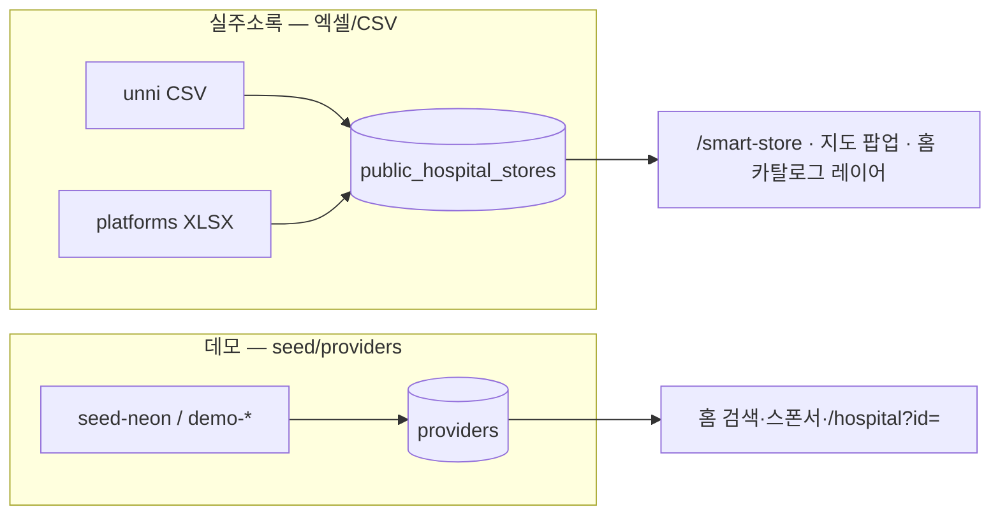

# 실병원명(엑셀·CSV) 반영 기획 — 데모 vs 공공 카탈로그

[v1 · 2026-10-30 · 세션 업로드 원본 기준]

## 결론 (한 줄)

**가능합니다.** 병원 **이름·주소·전화·출처 URL**은 이미 `public_hospital_stores` import 파이프라인으로 **엑셀/CSV 그대로** 넣도록 설계되어 있습니다.  
다만 **홈 검색·스폰서·`/hospital?id=`(providers)** 는 별도 **데모 DB**라서, “데모가 아닌 전체 사이트”로 바꾸려면 **노출 구역별 2~3단계 이식**이 필요합니다.

## 원본 파일 (레포·Dropbox 동기)

| 파일 | 레포 경로 | 건수(2026-10-30 집계) | 이름 컬럼 |
|------|-----------|----------------------|-----------|
| `unni_hospitals.csv` | `data/catalog/unni_hospitals.csv` | **1,225** | `병원명` |
| `med_platforms_hospitals.xlsx` | `data/catalog/med_platforms_hospitals.xlsx` | **34,236** | `상호` (없으면 `성명`) |
| **합계** | | **~35,461** | |

Dropbox 정본(동일 파일):  
`C:\Users\user\Dropbox\PC (9)\Downloads\구글주소록_3000건단위\`

Import 스크립트: `scripts/import-public-hospital-catalog.py`  
→ Neon 테이블 **`public_hospital_stores.name`** 에 실명 저장 (`external_key`로 upsert).

## 현재 사이트의 “두 갈래” 데이터



| UI | API / 테이블 | 병원명 출처 | 상단 DEMO 리본 |
|----|----------------|-------------|----------------|
| **스마트스토어** `/smart-store` | `GET /api/public-catalog/*` · `public_hospital_stores` | **실명 (import)** | 카탈로그 영역은 「공공 주소록」 표기 (데모 기관 아님) |
| **홈 · 내 주변** (카탈로그 체크) | 동일 + 지도 마커 | **실명** | 구독 병원 목록은 여전히 providers 혼재 |
| **병원 찾기(디렉터리)** | `GET /api/search` · `providers` | **데모/입점 seed** | DEMO 리본 유지 |
| **스폰서 카드** | `providers` + ads | **데모** | DEMO |
| **병원 상세** `/hospital?id=` | `GET /api/provider/:id` · `providers` | **데모** (`external_key` `demo-*`) | 가상 시연 문구 |

→ **“이름만 맞게”**의 최소 목표는 **Phase 1**만으로 달성 가능(스마트스토어·카탈로그 지도).  
→ **검색·상세까지 실명**은 **Phase 2~3** 필요.

## Phase 1 — 실명 노출 (권장 즉시) ✅ 2026-10-30 실행

**목표:** 엑셀 DB 이름이 사용자에게 보이는 1차 접점 = 스마트스토어 + 공공 카탈로그.

**실행 결과:** Neon `medipick-lexid` — **35,458건** upsert, 좌표 **29,386건** (시도 중심+jitter).  
로컬 재실행: `.\scripts\import-catalog-local.ps1` (`DATABASE_URL` 필요)

1. **원본 확인**  
   - `data/catalog/` 에 CSV·XLSX 최신본 유지 (세션 업로드본과 SHA/행수 비교).
2. **Neon import (prod)**  
   ```powershell
   cd E:\currsor_C\blog\medipick-repo
   # DATABASE_URL = Neon prod (Vercel과 동일)
   $env:IMPORT_UNNI_CSV = "E:\currsor_C\blog\medipick-repo\data\catalog\unni_hospitals.csv"
   $env:IMPORT_PLATFORMS_XLSX = "E:\currsor_C\blog\medipick-repo\data\catalog\med_platforms_hospitals.xlsx"
   python scripts/import-public-hospital-catalog.py
   ```
   또는 `.\scripts\import-catalog-from-dropbox.ps1` (Dropbox 경로).
3. **검증**  
   - `GET /api/public-catalog/stats` → total ~35k  
   - `/smart-store` 목록·팝업 **병원명 = CSV/XLSX와 일치** 샘플 10건  
   - 홈 「공공·플랫폼 병원 카탈로그 지도」 ON → 마커 클릭 시 동일 이름
4. **카피**  
   - 스마트스토어·카탈로그 팝업: 「데모」 대신 **「공공·플랫폼 수집 주소록 · 출처 표시」** (이미 `presentCatalogStore` free tier)  
   - **DEMO 리본**은 providers 쓰는 페이지만 유지 (혼동 방지)

**좌표 한계 (기획상 고지):**  
import 기본은 **시·군·구 중심 + 이름 기반 jitter** — 지도 핀은 “병원 건물 정확 좌표”가 아닐 수 있음.  
정밀 좌표는 Phase 2b (Google Geocoding API + `geocode_status=exact`).

## Phase 2 — 홈 검색에 실주소록 혼합/전환

**목표:** 「병원 찾기」에서도 `루비성형외과의원` 같은 **실명** 검색.

| 옵션 | 설명 | 난이도 |
|------|------|--------|
| **2A 하이브리드** | `/api/search` 결과에 `providers` + `public_hospital_stores` UNION (카드에 `store_type` 배지) | 중 |
| **2B 카탈로그 우선** | 검색 기본을 `/api/public-catalog/nearby?q=` 또는 신규 `/api/public-catalog/search` | 중 |
| **2C providers 축소** | 데모 provider 수를 줄이고, PRO 구독만 providers 유지 | 운영 정책 |

**이름 매칭 (선택):**  
전화 normalize + `norm_name(병원명)` + 주소 앞 2토큰으로 `linked_provider_id` 연결 → 구독 병원과 공공 카드 1:1 (월 PRO).

## Phase 3 — 상세·예약 페이지를 실기관으로

**목표:** `/hospital?id=` 또는 **`/store?id=`(신규)** 가 카탈로그 행을 렌더.

- **3A** `GET /api/public-catalog/:id` + `store.html` (예약은 “전화·프로필 URL” 중심, claims 없음)  
- **3B** PRO만 `linked_provider_id` → 기존 `/api/appointments` 유지  
- **의료법·표시:** 실명이어도 **진료 추천·후기·의료진**은 입점·검증 전까지 노출 금지 (현 hospital.js 톤 유지)

## Phase 4 — “DEMO 리본” 제거 조건

| 조건 | 설명 |
|------|------|
| providers 데모 비율 | 홈 스폰서/검색에서 demo-* 비중 0% 또는 “시연 구역” 페이지 분리 |
| AI·예약 | 미연동 API는 「요청 접수 시연」 명시 |
| 법무 | 공공 수집 데이터 이용범위·출처(`source_platform`, `profile_url`) UI 필수 |

## 리스크·비판적 검토

| 항목 | 내용 |
|------|------|
| **이름 정확도** | import는 **수집 시점 상호** — 폐업·개명·지점명 혼동 가능 → `updated_at`·원문 URL 필수 |
| **중복** | 플랫폼별 동일 병원 다건 → `external_key` per platform (의도적), 통합은 Phase 2+ dedupe 정책 |
| **데모 혼동** | 한 화면에 providers+카탈로그 동시 노출 시 이름이 “실명 vs 가명” 섞임 → 배지·섹션 분리 |
| **좌표** | jitter 지도는 **위치 참고용** — “내 주변 3km”는 Google 정 geocode 후 신뢰 |

## 추천 로드맵 (단일안)

1. **이번 주:** Phase 1 import prod 재실행 + 스마트스토어/카탈로그 QA (실명 35k)  
2. **다음:** Phase 2A 하이브리드 검색 (실명 카드 + 광고 provider 분리)  
3. **입점 연동 후:** Phase 3 `/store?id=` + PRO `linked_provider_id`  
4. **마지막:** DEMO 리본을 admin/시연 전용 경로로만 축소

## 세션 업로드 파일 점검 체크리스트

- [ ] `med_platforms_hospitals.xlsx` 행 수 ≈ 34,236  
- [ ] `unni_hospitals.csv` 행 수 ≈ 1,225  
- [ ] 샘플 3건: `병원명`/`상호` ↔ `/api/public-catalog/nearby?q=` 검색 일치  
- [ ] prod `public_hospital_stores` count ≈ 35k (`/api/public-catalog/stats`)

관련 정본: `docs/MEDIPICK_SMART_STORE.md`, `data/catalog/README.md`
